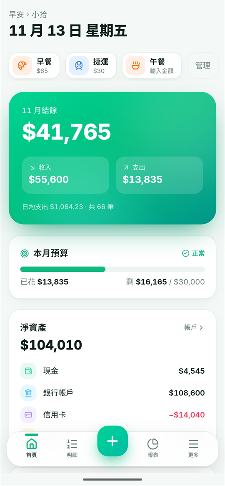
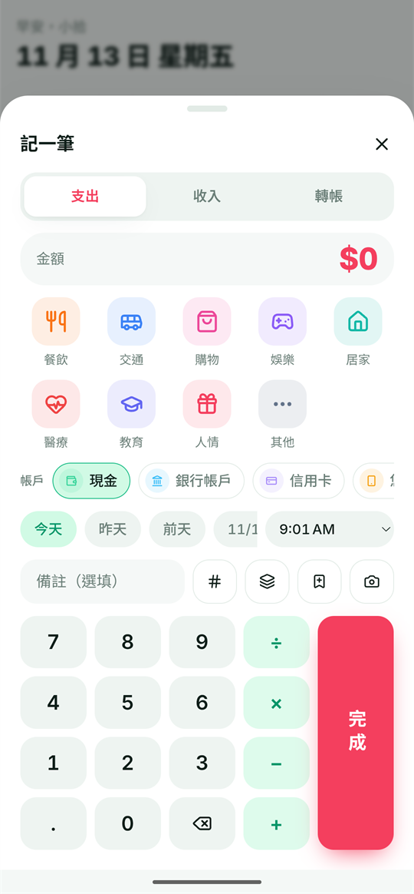
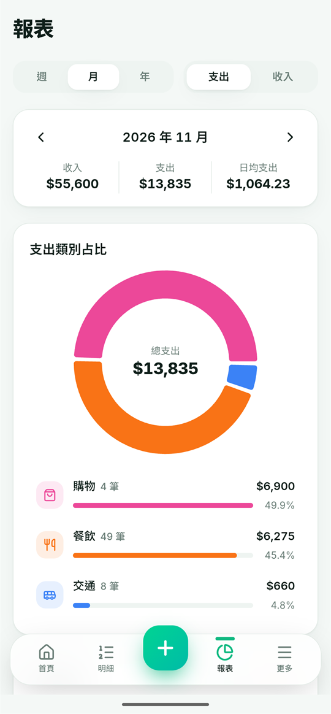
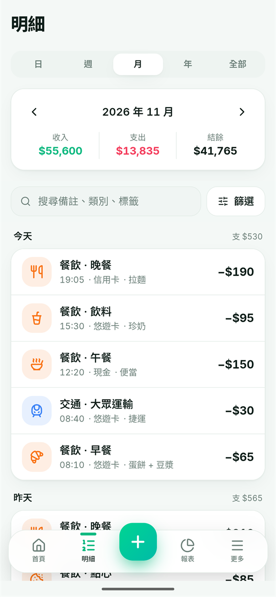
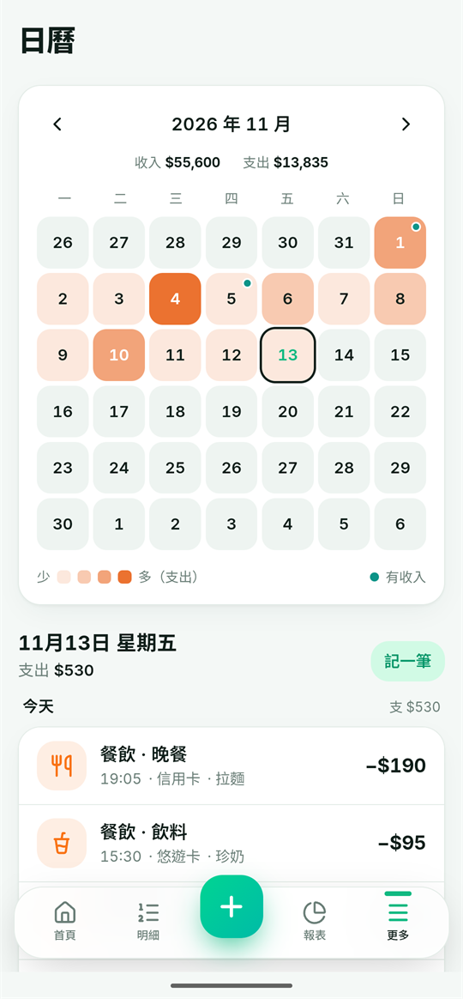
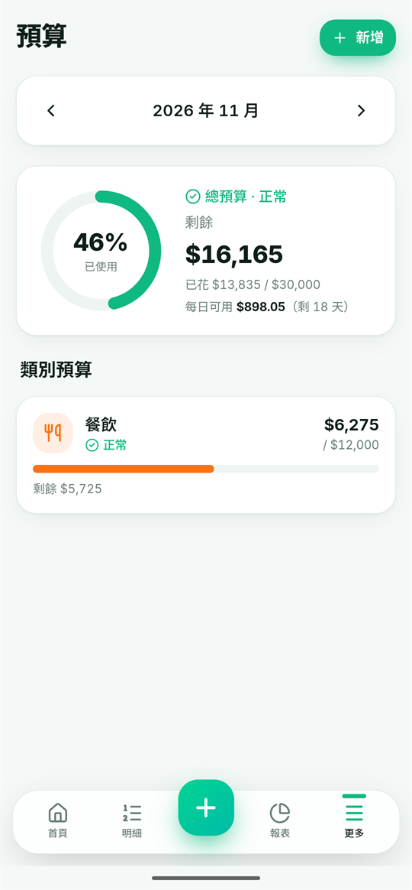
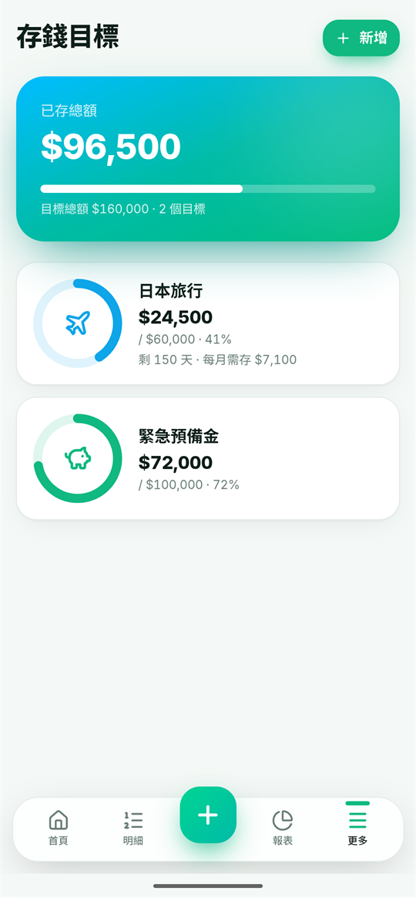
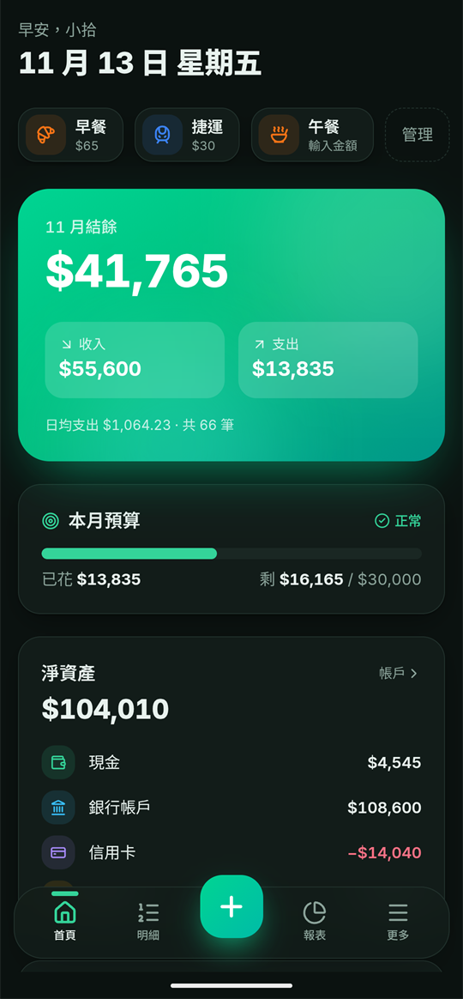
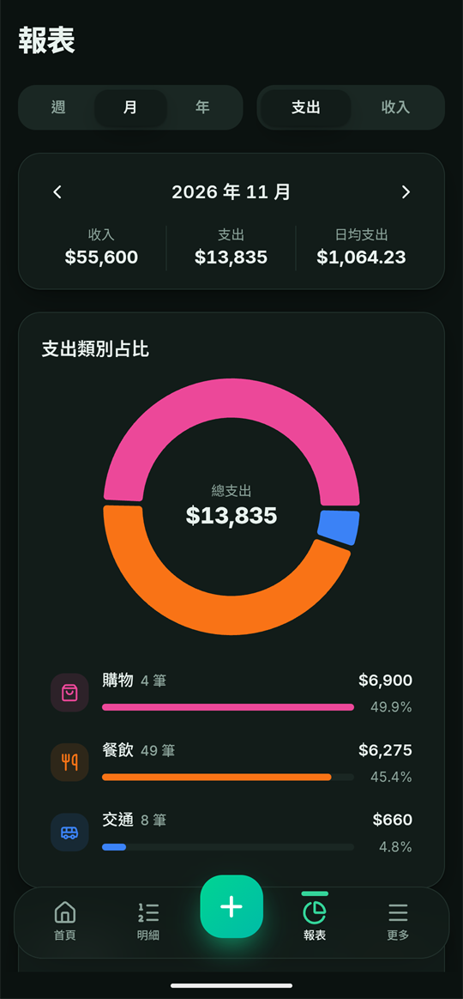

<p align="center">
  
</p>

<h1 align="center">拾分 Tallydew · Android App</h1>

<p align="center">
  把每一分錢都拾起來 — 完全離線、資料加密、只存在你手機上的記帳 App
</p>

<p align="center">
  
  
  
  
  
</p>

<table align="center">
  <tr>
    <td></td>
    <td></td>
    <td></td>
  </tr>
  <tr>
    <td align="center"><b>首頁</b><br /><sub>結餘、預算、淨資產一眼看完</sub></td>
    <td align="center"><b>記一筆</b><br /><sub>計算機鍵盤，一個畫面完成</sub></td>
    <td align="center"><b>報表</b><br /><sub>類別占比與收支趨勢</sub></td>
  </tr>
</table>

> 這是 `mobile` 分支的 Android App。多人使用、需架設伺服器的網頁版請見 [`main` 分支](../../tree/main)。

---

## 為什麼是拾分

- **完全離線**：App 沒有網路權限，不需註冊帳號，不收集任何資料
- **資料加密**：資料庫以 SQLCipher 加密，金鑰存放在 Android Keystore
- **只在這支手機**：不會上傳雲端，也排除在系統雲端備份與裝置轉移之外；需要搬家時用加密備份檔
- **快速**：常用模板一鍵入帳，記一筆從開啟到完成只要一個畫面

## 畫面一覽

<table align="center">
  <tr>
    <td align="center"><br /><b>明細</b><br /><sub>依日期分組、搜尋與篩選</sub></td>
    <td align="center"><br /><b>日曆</b><br /><sub>每日支出熱度圖</sub></td>
    <td align="center"><br /><b>預算</b><br /><sub>總預算與類別預算</sub></td>
  </tr>
  <tr>
    <td align="center"><br /><b>存錢目標</b><br /><sub>進度與每月需存金額</sub></td>
    <td align="center"><br /><b>深色模式</b><br /><sub>系統列顏色跟著主題切換</sub></td>
    <td align="center"><br /><b>深色報表</b><br /><sub>圖表配色經色盲安全驗證</sub></td>
  </tr>
</table>

<sub>畫面中的資料皆為示範資料。</sub>

## 功能特色

### ✍️ 記帳
- 支出 / 收入 / 轉帳，類別 + 子類別、帳戶、備註、標籤
- 計算機鍵盤（+ − × ÷）與日期時間選擇器（今天 / 昨天 / 前天快捷）
- **常用模板**：首頁一鍵記帳，可在列表中刪除與排序
- **收據照片**：拍照或選圖，自動壓縮後存入加密資料庫
- **分期付款**：記一筆時直接設定期數，自動產生每月一期

### 📋 明細、報表與日曆
- 日 / 週 / 月 / 年 / 全部切換，依日期分組並顯示每日小計
- 關鍵字搜尋與多條件篩選，左滑編輯 / 刪除並可復原
- 類別甜甜圈圖、類別排行、收支趨勢；日曆呈現每日支出熱度

### 🎯 預算、目標與自動化
- 每月總預算與類別預算，超支即時提醒，顯示每日可用金額
- 存錢目標：存入 / 提領紀錄、每月需存金額試算
- 定期交易：開啟 App 或回到前景時自動入帳，過去的開始日期自動補記

### 💳 帳戶與多幣別
- 現金 / 銀行 / 信用卡 / 電子支付等帳戶，即時餘額與淨資產
- 信用卡結帳日、繳款截止日與本期應繳
- 17 種常用幣別，外幣以記帳當下匯率換算

### 📦 資料匯入與備份
- 匯出 CSV / Excel，透過系統分享選單存到檔案、雲端硬碟或傳給他人
- 匯入 CSV / Excel 先預覽再寫入，可略過重複
- 完整備份可設定密碼（AES-GCM 加密），也能還原網頁版的備份檔

## 安全與隱私

| 項目 | 做法 |
|---|---|
| 資料庫 | SQLCipher 全庫加密，32 位元組隨機金鑰存於 Android Keystore；加密不可用時拒絕開啟 |
| App 鎖 | 4–6 位數 PIN（PBKDF2 雜湊），可搭配指紋 / 臉部辨識快速解鎖；閒置自動上鎖 |
| 防暴力破解 | PIN 每錯 5 次鎖定，時間逐次拉長（1 分 → 5 分 → 15 分 → 1 小時 → 4 小時）；以開機後單調時鐘計時，調整系統時間無法略過 |
| 畫面隱私 | 切到背景時遮住餘額；Android 13 以上最近使用畫面的縮圖為空白 |
| 網路與備份 | 沒有網路權限；關閉系統備份與裝置轉移；匯出檔只暫存在 App 私有資料夾並自動清除 |
| 網頁層 | 正式版套用嚴格的 Content-Security-Policy，只允許 App 本身的資源 |

## 技術架構

| 層級 | 技術 |
|---|---|
| 介面 | React 19 · TypeScript · Vite · Tailwind CSS v4 · Framer Motion · Recharts · TanStack Query · Zustand |
| 原生容器 | Capacitor 7（Android），自製 `NavBar`、`Secure` 原生外掛 |
| 資料 | `@capacitor-community/sqlite` + SQLCipher；瀏覽器開發模式改用 sql.js（WASM） |
| 商業邏輯 | `packages/core`：帳務、統計、分期、匯入匯出，可在 Node 以 better-sqlite3 測試 |
| 共用 | `packages/shared`：Zod 驗證 schema 與型別 |

```
ledger-app/
├─ apps/mobile        React 介面 + Capacitor Android 專案（apps/mobile/android）
├─ packages/core      裝置上執行的商業邏輯與 SQLite schema
├─ packages/shared    Zod schema / 型別
└─ docs/              規劃文件與截圖
```

## 開發與建置

需求：Node.js 20.19 以上、Android Studio（使用其內附 JDK）

```bash
npm install
npm run dev            # 在瀏覽器開發（http://localhost:5173，sql.js 模擬資料庫、未加密）
npm test               # 執行 packages/core 測試
npm run android:sync   # 建置網頁並同步到 Android 專案
npm run android:open   # 以 Android Studio 開啟，選擇模擬器或實機執行
```

命令列建置 APK（Windows，於 `apps/mobile/android`）：

```bash
JAVA_HOME="/c/Program Files/Android/Android Studio/jbr" ./gradlew assembleDebug
```

<details>
<summary><b>開發備註</b></summary>

- `apps/mobile/android/local.properties` 需指向 Android SDK（使用正斜線），此檔不納入版本控制。
- App 識別碼為 `com.wyc915.tallydew`；變更識別碼會被系統視為另一個 App，原有資料無法讀取。
- 舊名稱時期的備份（`diandi-ledger`、`DIANDI-ENC1`）與網頁版備份（`mint-ledger`）仍可還原。

</details>
