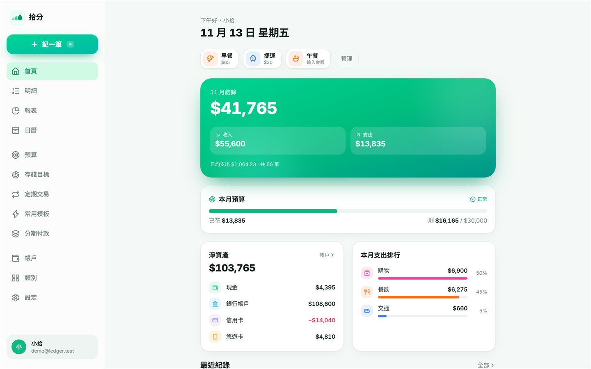
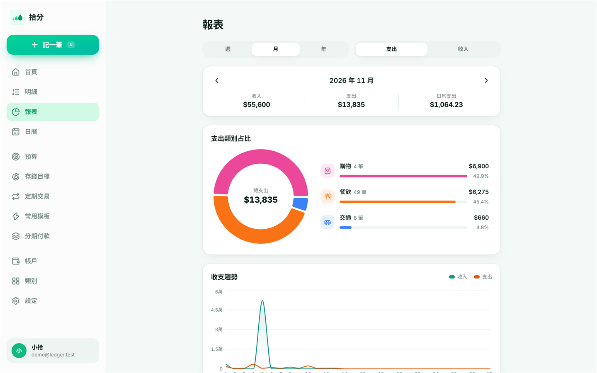
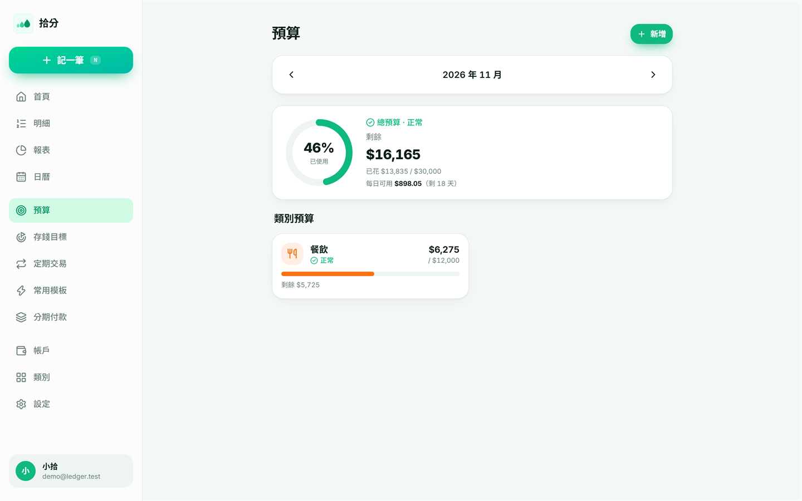
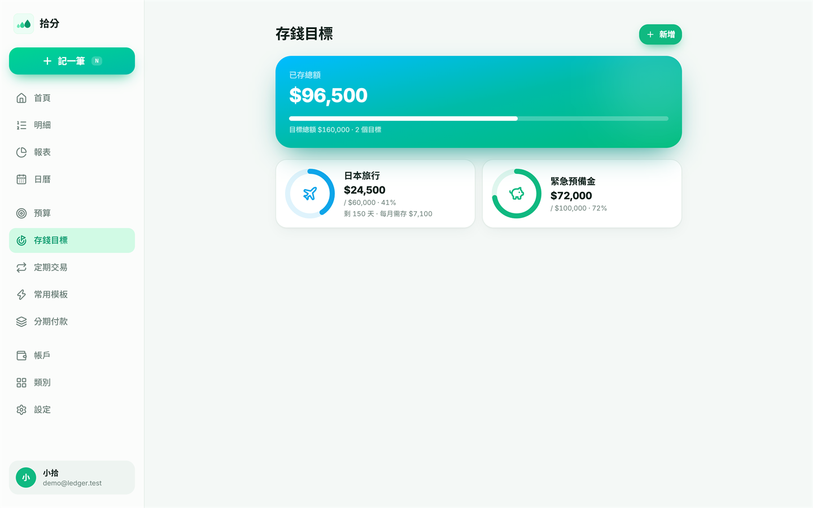
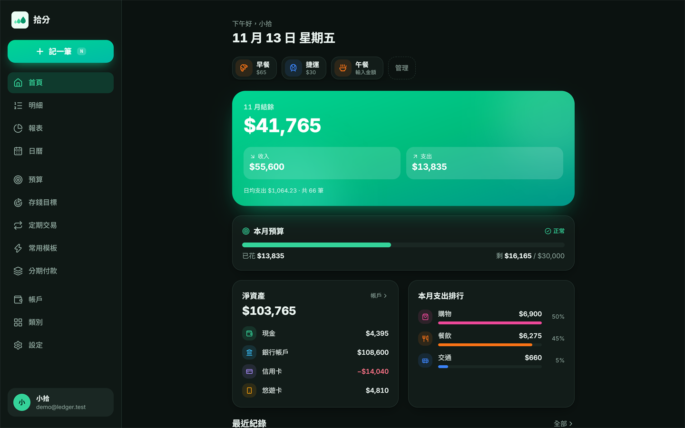

<p align="center">
  
</p>

<h1 align="center">拾分 Tallydew</h1>

<p align="center">
  把每一分錢都拾起來 — 現代、簡潔、動畫流暢的多人記帳 Web App
</p>

<p align="center">
  
  
  
  
  
</p>

<p align="center">
  
</p>

> 想要完全離線、資料只存在手機上的版本？請見 [`mobile` 分支](../../tree/mobile)的 Android App。

---

## 畫面一覽

<table>
  <tr>
    <td width="50%"><p align="center"><b>報表</b> · 類別占比與收支趨勢</p></td>
    <td width="50%"><p align="center"><b>明細</b> · 分組、搜尋與篩選</p></td>
  </tr>
  <tr>
    <td><p align="center"><b>日曆</b> · 每日支出熱度</p></td>
    <td><p align="center"><b>預算</b> · 總預算與類別預算</p></td>
  </tr>
  <tr>
    <td><p align="center"><b>存錢目標</b> · 進度與每月需存金額</p></td>
    <td><p align="center"><b>深色模式</b> · 淺色 / 深色 / 跟隨系統</p></td>
  </tr>
</table>

<sub>畫面中的資料皆為示範資料。</sub>

## 功能特色

### ✍️ 記帳
- 支出 / 收入 / 轉帳，類別 + 子類別、帳戶、備註、標籤
- 內建計算機鍵盤（+ − × ÷，支援實體鍵盤），快捷鍵 `N` 隨時記一筆
- 日期時間選擇器：今天 / 昨天 / 前天快捷、月曆滑動切換
- **常用模板**：首頁一鍵記帳，金額完整時直接入帳並可復原
- **收據照片**：每筆最多 10 張，上傳前自動壓縮，點縮圖放大

### 📋 明細與搜尋
- 日 / 週 / 月 / 年 / 全部切換，依日期分組並顯示每日小計
- 關鍵字搜尋（備註、類別、標籤），依類型、類別、帳戶、標籤、金額區間篩選
- 左滑編輯 / 刪除，刪除後可「復原」

### 📊 報表與日曆
- 支出 / 收入類別甜甜圈圖（可展開子類別）、類別排行、收支趨勢、近 6 個月收支對比
- 日曆以單色熱度呈現每日支出，點選日期即可查看當日明細或補記
- 圖表配色經色盲安全驗證

### 🎯 預算與目標
- 每月總預算與類別預算，接近上限（80%）與超支即時提醒，顯示每日可用金額
- 存錢目標：目標金額與期限、存入 / 提領紀錄、每月需存金額試算、達成慶祝動畫

### 🔁 自動化
- **定期交易**：每 N 天 / 週 / 月 / 年自動入帳，可暫停；過去的開始日期自動補記，正確處理月底日期
- **分期付款**：3–36 期自動產生每月一期，可提前結清；未到期的期數不計入目前餘額

### 💳 帳戶與多幣別
- 現金 / 銀行 / 信用卡 / 電子支付等帳戶，即時餘額與資產、負債、淨資產
- 信用卡結帳日與繳款截止日、本期應繳、到期倒數與逾期提示
- 17 種常用幣別，外幣以記帳當下匯率換算，報表與預算一律以主要幣別計算

### 📦 資料匯入與備份
- 匯出 CSV（Excel 直接開啟不亂碼、防公式注入）或 Excel（.xlsx）
- 匯入 CSV / Excel 先預覽，標示錯誤列與將自動建立的帳戶 / 類別 / 標籤，可略過重複
- 完整 JSON 備份（可含收據照片）與還原

### 🔒 帳號與安全
- 多人帳號，各使用者資料完全隔離；密碼以 bcrypt 雜湊，JWT 存於 httpOnly Cookie
- 登入失敗與 PIN 錯誤次數限制
- PIN 碼鎖：閒置自動鎖定，由伺服器強制執行（鎖定時 API 回傳 `423`）

### ✨ 介面體驗
- 手機優先的響應式設計（桌機側邊欄、手機底部導覽），PWA 可加入主畫面
- 淺色 / 深色 / 跟隨系統，流暢的數字滾動與轉場動畫

## 技術架構

| 層級 | 技術 |
|---|---|
| 前端 | React 19 · TypeScript · Vite · Tailwind CSS v4 · Framer Motion · Recharts · TanStack Query · Zustand |
| 後端 | Node.js · Fastify 5 · TypeScript (tsx) |
| 資料庫 | SQLite (better-sqlite3) · Drizzle ORM |
| 共用 | `packages/shared`：Zod 驗證 schema 與型別，前後端共用 |
| 驗證 | Email + 密碼（bcrypt），JWT 存於 httpOnly Cookie |

```
ledger-app/
├─ apps/server      Fastify API + SQLite（資料存在 apps/server/data/ledger.db）
├─ apps/web         React 前端（PWA）
└─ packages/shared  Zod schema / 型別
```

## 開始使用

需求：Node.js 20.19 以上

```bash
npm install
npm run dev          # 同時啟動 API (http://127.0.0.1:3001) 與前端 (http://localhost:5173)
```

開啟 http://localhost:5173 ，註冊帳號即可使用（會自動建立預設類別與帳戶）。

### 正式部署（單一服務）

```bash
npm run build        # 建置前端到 apps/web/dist
npm start            # API 同時提供前端靜態檔，預設 http://127.0.0.1:3001
```

| 環境變數 | 說明 | 預設 |
|---|---|---|
| `API_PORT` | API 監聽埠 | `3001` |
| `HOST` | 監聽位址（對外開放設 `0.0.0.0`） | `127.0.0.1` |
| `DATA_DIR` | SQLite 與金鑰存放目錄 | `apps/server/data` |
| `JWT_SECRET` | JWT 簽章金鑰（未設定會自動產生並存於 `DATA_DIR`） | 自動 |
| `COOKIE_SECURE` | 透過 HTTPS 提供服務時設為 `1` | 關閉 |

備份：直接複製 `DATA_DIR/ledger.db` 即可。

> **注意**：帳戶餘額只計算「到現在為止」的紀錄，未來日期的紀錄（例如後續分期）會在到期時才計入。

<details>
<summary><b>開發備註</b></summary>

- 新增套件請在專案根目錄執行 `npm install <pkg> -w apps/web`。根目錄 `package.json` 以 `optionalDependencies` 固定了 Windows 版 esbuild / rolldown 原生套件，避免 npm 在 workspace 安裝時誤刪（其他平台會自動略過）；升級 vite / tsx 時請一併更新這兩個版本號。
- `npm audit` 會回報 exceljs 依賴的 `uuid` 有 moderate 警告；該弱點只影響 uuid v3/v5/v6 搭配 buffer 參數，exceljs 僅使用 `v4()`，不受影響。

</details>

<details>
<summary><b>API 一覽</b></summary>

| 範圍 | 端點 |
|---|---|
| 帳號 | `/api/auth/{register,login,logout,me,password}` · `/api/auth/{pin,pin/verify,lock,ping,lock-settings}` |
| 帳戶 / 類別 | `/api/accounts` · `/api/accounts/:id/cycle` · `/api/categories` · `/api/tags` |
| 紀錄 | `/api/transactions`（GET 支援 `from,to,q,type,categoryIds,accountIds,tagIds,min,max,limit`）· `/api/transactions/summary` · `/api/transactions/:id/restore` |
| 收據 | `/api/transactions/:id/attachments` · `/api/attachments/:id` |
| 統計 / 規劃 | `/api/stats/{trend,categories}` · `/api/budgets` · `/api/recurring` · `/api/templates` · `/api/goals` · `/api/goals/:id/entries` · `/api/installments` |
| 幣別 | `/api/rates` · `/api/settings/base-currency` |
| 資料 | `/api/export/transactions?format=csv\|xlsx` · `/api/import/{preview,commit}` · `/api/backup` · `/api/backup/restore` |

</details>
